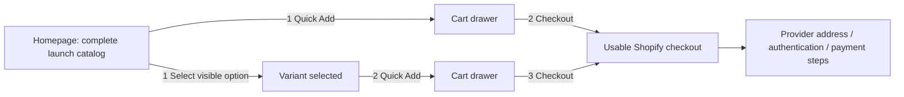
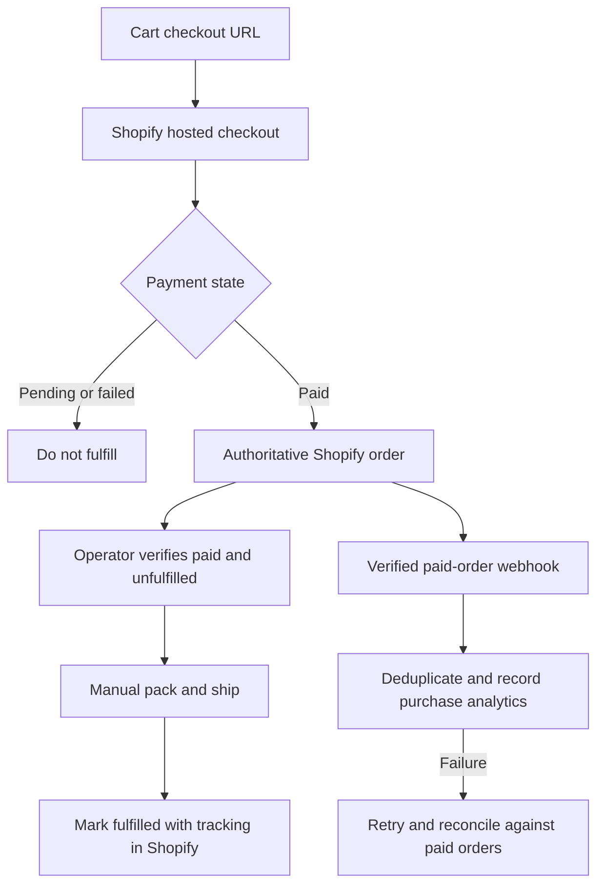

# EasyEcom storefront plan

Research date: October 17, 2026 (America/Denver). Status: Après Club approved; the local storefront design and an opt-in Stripe-hosted pilot checkout are implemented. Account connections, live validation and launch remain pending. See docs/DESIGN_REVIEW.md for design implementation evidence and docs/FIRST_TEN_ORDERS.md for the pilot.

## Fulfillment decision update

Latest decision (October 17, 2026): defer the intended Shopify–Printful connection until reviewing the first 10 paid orders. Use Stripe-hosted Checkout with the existing mixed-design bag, and manually place Printful orders. The small server integration is implemented and off by default; account configuration, approved supplier products/artwork/costs, hosting and a real end-to-end order remain pending. See `docs/FIRST_TEN_ORDERS.md` for the pilot and `docs/DOTS_AGENT_COMMERCE_HANDOFF.md` for the later automation task. Interest requests and test/sample purchases are not paid customer demand.

The user selected supplier-managed print-on-demand: the supplier prints, packs, and ships each order. This supersedes the original manual-first launch assumption below. A generic fulfillment foundation now covers POD and stocked/warehouse routes, with per-variant mappings, capability checks, immutable jobs, and duplicate-safe simulation. See `docs/FULFILLMENT_ARCHITECTURE.md` for the current implementation and production requirements. No real supplier, queue, commerce backend, or payment service is connected. Prefer a compatible Shopify supplier app as the single execution owner; use a direct adapter only when needed.

## Recommendation

Choose **Après Club**, the Playful Outdoor Culture direction: Bricolage Grotesque headlines, DM Sans UI, warm cream, forest ink, apricot merchandise fields, and a restrained red accent. Retain the grid discipline of Field Notes and the editorial restraint of Alpine Editorial. Après Club is a working creative name, not a cleared commercial brand.

Use **Next.js App Router + TypeScript + Tailwind with Shopify as the commerce backend**, Shopify-hosted checkout, and Shopify Admin for operations. Use Vercel Pro for commercial storefront hosting. Keep a small provider boundary around catalog and cart operations; implement only Shopify in V1. Start with manual fulfillment and native transactional notifications. Defer Supabase, a separate CMS, Resend, and a custom operations dashboard unless a verified requirement needs them.

Shopify's Headless channel supports custom interfaces using the developer's chosen framework ([official channel](https://apps.shopify.com/headless)). The Storefront Cart API supplies a checkout URL for redirecting into Shopify web checkout ([cart documentation](https://shopify.dev/docs/storefronts/headless/building-with-the-storefront-api/cart/manage)). This is a recommendation based on minimizing operational work, not evidence of higher conversion for our unbuilt store.

## Repository findings and assumptions

The workspace contains a Git directory and the consolidated planning prompt. There is no application, package manifest, design system, catalog, integration, test suite, or applicable AGENTS.md discovered in the workspace or inspected ancestor directories. The original prompt is untracked; do not overwrite or discard it. Start a single application rather than a monorepo.

Planning assumptions: US merchant, USD, domestic physical-product shipping, small inventory batches, one shipping origin, 12 initial designs, guest checkout, and manual fulfillment. These assumptions permit planning; they do not authorize commercial shipping, tax, or fulfillment claims. Seller location, sales-tax setup, shipping service, production costs, approved artwork, inventory counts, domain, and policies must be confirmed before launch.

## Research and what it contributes

These are visual observations and proposed adaptations, not claims that the references' conversion performance has been measured. Five actual references were visually inspected in a browser. Casely was inspected at desktop and a 390 × 844 mobile viewport; observations are session-specific and affected by responsive loading.

| Reference | Observed contribution | Proposed adaptation |
| --- | --- | --- |
| [Casely](https://www.getcasely.com/) | Prominent campaign product compositions, New Arrivals and Trending merchandising, clear product naming and prices. Current navigation is extensive and the campaign occupies much of the initial viewport. | Make merchandise the brand's visual vocabulary; shorten the hero, expose Quick Add, simplify navigation. Do not inherit the large-store navigation or campaign carousel. |
| [Heist](https://www.heist.co/) via [Land-book](https://land-book.com/websites/101139-specialty-decaf-and-1-4-caf-coffee-without-a-curfew-heist) | Strong contrast between narrow expressive serif headlines and heavy identity lettering; assertive product imagery and voice. | Give headlines and product art distinct typography roles. Keep the visual confidence while omitting the oversized video/campaign lead-in. |
| [SIHA](https://siha.com.au/) via [SiteInspire](https://www.siteinspire.com/website/13654-siha) | Restrained header, natural photography, open product layouts, quiet rules and whitespace. Product controls exist for some merchandise. | Borrow breathing room and orderly price/action hierarchy; maintain visible purchase controls on mobile. |
| [The Surfer’s Journal Archives](https://archives.surfersjournal.com/) via [SiteInspire](https://www.siteinspire.com/website/13639-the-surfers-journal-archives) | Sparse navigation, serif typography, isolated cover artwork, generous colored field, issue/year indexing. | Treat decals as collectible graphic objects. Use catalog indexing in Field Notes; omit the introductory animation and archive navigation behavior. |
| [Graza](https://www.graza.co/) | Distinctive lettering, humorous voice, cream/green identity, product families with straightforward names and use cases. | Carry personality into purchasing surfaces and product families, using an original palette, lettering treatment, and artwork. Omit video dependency and lengthy pre-purchase storytelling. |

[Awwwards](https://www.awwwards.com/), [SiteInspire](https://www.siteinspire.com/), and [Land-book](https://land-book.com/) were opened for reference discovery. Commerce Cream timed out through the research tool. Godly redirected to recent.design, which the research tool could not access. Fontshare's website/family pages returned little inspectable text; its indexed catalog identifies some preferred families as closed source. Their exact distribution terms were not established, so no Fontshare font software is bundled or assumed redistributable. The recommendations below use fonts whose OFL files were directly checked.

## Three art directions

The conversation contains original desktop and mobile composition studies with illustrative typographic decals and a local cart preview. These are design proposals, not application code, production product artwork, or validated checkout integrations. The mobile panel is a compact composition study rather than a pixel-equivalent 390px screenshot. All prices are illustrative. Final product photography, sizes, materials, and claims remain unapproved.

### A — Alpine Editorial / Editorial DTC

**Personality:** a mountain-culture magazine with a shop inside. Headline: “A little altitude. A lot of attitude.”

- Typography: Instrument Serif regular/italic for editorial display; Space Grotesk 400/500/700 for product and UI text. Display 88–104px desktop, 48–56px mobile; body 16px/1.5; product names 16–18px/1.25. Display tracking −0.035em, line-height 0.95. Short italic emphasis only.
- Palette: paper #F5F0E7; ink #282C22; rust accent #923D29; sage product field #D8DECD; structural rule #C7C5B7. Use ink on paper/sage and paper on rust. Validate every final state for contrast.
- Grid: 12 columns, max 1440px, 48px desktop gutters, 24px gaps; mobile 4 columns, 16px gutters, 12px gaps. Spacing 4/8/12/16/24/32/48/64.
- Desktop: wordmark left, two shopping links, bag right; short asymmetrical hero with copy and one oversized decal composition; three-column curated row, then the complete catalog.
- Mobile: compact wordmark and bag, short typography lead-in, two-column products. Remove the separate hero art rather than squeeze desktop artwork into a narrow crop. Keep product names and Quick Add outside the artwork.
- Cards: open layouts with square 1:1 image fields and clear text/action stacks. No card container shadow or decorative border. 72–78% merchandise occupancy with consistent scale.
- Buttons: square corners, 1px outline, full card width, ink fill on hover/focus-compatible active states. Detail links underlined. Radius 0 on commerce controls, up to 2px on images.
- Photography: precise overhead artwork and quiet studio mockups on matte surfaces; one honest bottle/cooler context image below the shopping grid. No unrelated landscapes.
- Motion: image shift up to 2px over 140ms; cart 180ms ease-out. No page entrance choreography.
- Signature: expressive italic phrase paired with a calm collectible-object presentation.
- Tradeoff: premium and versatile, but less immediate humor than Après Club. Guard against editorial content pushing purchase controls down the page.

### B — Field Notes / Modern Swiss Commerce

**Personality:** a field catalog for people who enjoy the outside without taking themselves too seriously. Headline: “High country. Low stakes.”

- Typography: Space Grotesk 500/700 for headlines and readable commerce text; IBM Plex Mono 400/500 for small indices, prices, and collection labels. Display 80–96px desktop, 44–52px mobile; body 16px/1.5; metadata 12–13px, never long prose in mono. Tracking −0.055em display, normal on body.
- Palette: chalk #FBFAF6; forest-black #202820; citron #C3DB54; field gray #E9ECE7; rule #B6BFB5. Citron supports dark text, never small light text.
- Grid: 12 columns, max 1440px, 40px desktop gutters, shared 1px rules; mobile 4 columns, 16px gutters. Spacing 4/8/16/24/32/48/72.
- Desktop: compact wordmark, Catalog/Collections/About navigation; wide typographic statement with short right-aligned note; indexed product matrix with shared borders, equal image boxes, and aligned purchasing rows.
- Mobile: statement becomes three short lines; two-column matrix remains; each card exposes the full price and action. Filter controls sit after the initial merchandise, with a visible reset when active.
- Cards: squared, border-defined cells; neutral backgrounds, identical artwork scale and baseline; product identifier separate from product name. 1:1 imagery.
- Buttons: solid ink rectangles, 0 radius, no shadows, 44px minimum coarse-pointer hit targets. Small underlined secondary links.
- Photography: consistent orthographic decal scans/mockups; one clearly legible silhouette per tile; exact shared camera angle for context images.
- Motion: 100–120ms color response and 160ms cart translation; no rotating merchandise.
- Signature: index numbers, typographic precision, continuous grid rules.
- Tradeoff: easiest visual system to transfer to another catalog, but may feel too serious for humorous stickers. Avoid letting indices dominate actual product names.

### C — Après Club / Playful Outdoor Culture — recommended

**Personality:** an independent Colorado goods brand with a point of view. Headline: “Good vibes. Bad traffic.”

- Typography: Bricolage Grotesque 600/800 for identity, headlines, and short product names; DM Sans 400/500/700 for body and controls. Display 88–112px desktop, 48–60px mobile, line-height 0.9–0.96 and tracking −0.055em; product names 17px/1.2; body 16px/1.5; labels 12px/1.3. Avoid all-caps paragraphs.
- Palette: cream #F8F0D9; forest ink #243D33; apricot #F0BF77; tomato #BD3D2B; citron #D8E77A. Sage #D4DFB6 and clay #E4BAAA are secondary merchandise backgrounds. Primary controls: cream on forest. Red is a restrained emphasis, not an entire page background.
- Grid: 12 columns, max 1440px, 40px gutters, 20–24px gaps. Mobile 4 columns, 16px gutters, 12px gaps. Spacing 4/8/12/16/24/32/48/64. Four product columns on large desktop, three at intermediate widths, two on mobile.
- Desktop: solid forest masthead; short apricot hero with heavy headline and one deliberate sticker arrangement; immediate “Pick your personality” purchasing row; all designs and collection shortcuts follow.
- Mobile: short stacked headline, no separate collage above products; compact wordmark, Shop/Menu control and bag; first two product cards include visible Quick Add. Exact above-fold target must be verified at 390 × 844 with loaded fonts and actual content.
- Cards: open layout with distinctive arched image fields, independent artwork silhouettes and consistent image occupancy. Text and controls remain straight and stable; no randomized rotation of interactive elements. 1:1 source assets; up to 1:1.1 presentation crop if artwork remains intact.
- Buttons: forest rectangular blocks with 3px radius and direct “Quick add” label; count/added feedback appears in text. Only occasional decal graphics use circles or irregular shapes. No pills across the entire UI.
- Photography: custom vector/typographic decals, clear white die-cut edge, warm studio light, color fields keyed to collections. Real context shots of bottles, coolers and bumpers after shopping content. Never imply unverified durability or material performance.
- Motion: art-only rotation of at most 2 degrees on pointer hover, 120ms add feedback, 180ms drawer using cubic-bezier(.2,.8,.2,1). No scrolling text or animation gate. Reduced motion removes transforms.
- Signature: oversized tightly set lettering, crisp die-cut artwork, varied image-field geometry, and dry local humor.
- Tradeoff: strongest first-brand character, but needs original polished merchandise. Keep the collage limited to the hero and preserve consistent shopping geometry.

### Font licensing and performance

The checked license files identify [Instrument Serif](https://raw.githubusercontent.com/google/fonts/main/ofl/instrumentserif/OFL.txt), [Space Grotesk](https://raw.githubusercontent.com/google/fonts/main/ofl/spacegrotesk/OFL.txt), [IBM Plex Mono](https://raw.githubusercontent.com/google/fonts/main/ofl/ibmplexmono/OFL.txt), [Bricolage Grotesque](https://raw.githubusercontent.com/google/fonts/main/ofl/bricolagegrotesque/OFL.txt), and [DM Sans](https://raw.githubusercontent.com/google/fonts/main/ofl/dmsans/OFL.txt) as SIL OFL fonts. Preserve each copyright and license when distributing font files; observe reserved-name conditions if modifying them. Final font assets must be checked against their accompanying license at implementation time.

For the chosen brand load only its two families, not all the exploration fonts. Self-host WOFF2, limit weights and character sets, use font-display:swap and metric-compatible fallbacks, preload only the critical face. Initial planning budget: ≤150KB transferred fonts, measured after selecting actual files. The browser study uses hosted font stylesheets for exploration; that is not the production loading strategy.

## Shopping and component specification

Homepage order: optional accurate announcement → compact masthead → short hero → first purchasable row → all 12 designs → collection shortcuts/context imagery → useful policies/footer. No pagination, load-more, carousel navigation, or mandatory filtering for the launch catalog. All 12 products are present on the default homepage. Label curated products “Featured” until real sales justify “Best sellers.”

ProductCard: image link to details; product name; explicit price; optional descriptive badge; inline option buttons if needed; independent Quick Add. Never nest buttons inside a full-card link. Reserve image dimensions and control space; loading must not shift adjacent cards. Use three or fewer directly visible purchasable combinations; initial recommendation is one standard matte size, with variants introduced only when necessary. Quantity defaults visibly to one; quantity is a cart line property rather than a variant.

Quick Add performs a server-authoritative cart mutation, then reveals the cart drawer with selected name, variant, quantity, price, subtotal, and checkout. Show pending feedback immediately, disable duplicate submission while pending, handle failure inline, and never redirect until cart mutation succeeds. Availability and totals are refreshed before checkout. Optimistic UI must roll back safely.

CartDrawer: quantity adjustment, remove, continue shopping, subtotal, concise shipping disclosure, eligible discount display, prominent Checkout. No mandatory upsell. Persist an opaque provider cart reference in a secure cookie; recover a missing/expired cart. Display a shipping-threshold indicator only when its currency, market, discount basis, and exclusions match backend rules. Taxes/shipping remain estimates until calculated by the provider.

Use an accessible dialog primitive for the overlay: labeled dialog, initial focus, focus containment, Escape, return focus, background inertness, non-obscured mobile checkout. Cart controls stay at least 44px on coarse pointers. Local design-study controls demonstrate appearance only and are not the final accessibility implementation.

Interaction budget:



Start from a fresh homepage and empty cart. Count navigation, opening option controls, selecting options, adding, and checkout. Explicitly record scroll distance/time, text entry, and necessary consent separately; do not disguise them as zero friction. Tests exercise every active in-stock variant at desktop and mobile; no hidden direct-link shortcut. Optional discovery paths can take more interactions, but the default path must pass. Guarantee applies to ≤20 homepage-listed designs with direct option buttons; reassess discovery and budgets before exceeding this limit.

## Architecture and costs

Prices are US public list-price assumptions checked October 17, 2026, excluding tax, domain, usage overages, optional apps, and business labor. Merchant-specific payment rates and eligibility must be verified before purchase.

| Area | Shopify-backed custom storefront | Stripe Checkout + custom catalog/orders |
| --- | --- | --- |
| Storefront | Next.js, TypeScript, Tailwind, Vercel Pro | Same |
| Catalog/admin | Shopify Admin; native publishing, media, variants, inventory | Build or integrate catalog editor, permissions, media, inventory tools |
| Cart/checkout | Storefront Cart API → hosted Shopify checkout | Server Checkout Session creation → hosted Stripe Checkout |
| Shipping/tax | Configure provider markets, shipping profiles and tax settings | Own configuration and additional integrations; payment tooling is not a full store back office |
| Orders/refunds | Shopify system of record and native operations | Own order database and fulfillment lifecycle; provider refund synchronization |
| Discounts | Native supported discounts; fixed multipack SKU initially | Own validated discount representation and provider session calculations |
| Upfront effort | Lower operations effort; API integration still required | Higher inventory/order/admin effort |
| Portability | Portable UI/config; backend data/API coupling remains | More data control; more code and maintenance responsibility |
| Baseline | $39/mo Shopify Basic monthly + $20/mo one Vercel Pro seat = about $59/mo | $25/mo Supabase Pro first project + $20/mo one Vercel Pro seat = about $45/mo, before email/worker services |
| Card assumption | Shopify Basic lists rates from 2.9% + $0.30 with eligibility conditions | Stripe lists 2.9% + $0.30 for domestic cards; other payment and optional products vary |

Sources: [Shopify pricing](https://www.shopify.com/pricing), [Vercel pricing](https://vercel.com/pricing), [Supabase pricing](https://supabase.com/pricing), [Stripe pricing](https://stripe.com/pricing). Shopify Basic annual billing is listed at $29/mo equivalent, making the corresponding baseline about $49/mo with Vercel; do not assume annual commitment. Vercel Hobby is restricted to noncommercial personal use ([plan terms](https://vercel.com/docs/plans/hobby)). PostHog's first 1M product analytics events/month are currently free within its published limits ([pricing](https://posthog.com/product-analytics/pricing)).

The approximate $14/month difference between these baseline stacks does not account for the custom route's substantial operations engineering. Choose Shopify for V1. Also consider a bespoke Shopify theme if minimum operating cost becomes the overriding goal; this reduces frontend hosting infrastructure but changes the reusable application's architecture. No platform purchase or annual commitment is approved by this plan.

Do not create a duplicate orders database for Shopify V1. Shopify remains authoritative for catalog, pricing, discounts, inventory, orders, refunds, and fulfillment status. Runtime inventory must not be trusted from a stale page cache. Next.js caches descriptive catalog content, invalidates on product updates, and uses authoritative cart responses for transactional behavior.

Routes: `/`, `/shop`, `/collections/[slug]`, `/products/[slug]`, `/cart` (accessible fallback), `/pages/[slug]`, `/sitemap.xml`, `/robots.txt`; hosted provider order confirmation/status. Proposed endpoints: `/api/cart`, `/api/checkout`, `/api/webhooks/shopify`. Pin a currently supported stable API version during implementation and document upgrade ownership.

Proposed boundaries (not files created today):

```text
app/                          routes, server rendering, metadata
components/commerce/          ProductCard, OptionButtons, QuickAdd, CartDrawer
components/brand/             Header, Hero, CollectionLinks, Footer
lib/commerce/types.ts         normalized view models and minimal provider interface
lib/commerce/shopify/         catalog, cart and checkout operations
lib/analytics/                explicit funnel events and consent boundary
brands/colorado/              config, merchandising, copy, tokens
brands/second-store/          reuse fixture, independent identity
public/brands/                original brand and product assets
tests/                        integration, journeys and webhook fixtures
docs/                         setup, architecture, operator and cloning guides
```

## Data and configuration ownership

| Entity | Essential fields | Authority |
| --- | --- | --- |
| Product | provider ID, slug, title, description, media/alt, collections/tags, status, SEO, featured order | Shopify + brand merchandising references |
| Variant | provider ID, SKU, option tuple, Money amount/currency, compare-at amount, purchasable status, inventory policy, fulfillment mapping | Shopify |
| Cart | opaque ID, lines (variant ID, quantity), authoritative costs, currency, applied discounts, warnings | Shopify; cookie stores reference only |
| Order | provider ID, immutable line/price snapshots, payment state, totals, shipping, fulfillment/refund states | Shopify; sensitive buyer data stays there |
| BrandConfig | name, logo, theme tokens, font assets, layout/card variants, navigation, homepage sections, contact/domain and metadata | validated brand files |
| Policies | slug, approved content and last review | Shopify content pages; brand config references handles |
| IntegrationConfig | shop domain, tokens, webhook secret, analytics configuration | server environment; public fields explicitly allowlisted |
| Event receipt/outbox | event ID, processing state, retry count, minimal payload reference | durable integration store only if automated side effects require one |

Prices must use exact decimal strings or minor-unit integers with currency-aware conversion, never binary floating-point arithmetic. Collections are many-to-many. Shipping profiles and commercial promotions are provider-owned; visual configuration references them, rather than silently defining independent financial rules.

Use a small validated BrandConfig with semantic tokens, two font roles, constrained section order, and card/hero variants. A new store should change `brands/<store>/`, `public/brands/<store>/`, catalog content in its independent Shopify store, and its deployment environment. It should not modify cart, checkout, or order logic. The second fixture is “Desk Ritual,” a quiet stationery brand with grayscale photography and editorial composition; this tests more than a palette swap. Digital products, POD and complex configurable products remain future adapter requirements, not implemented abstractions.

## Orders, reliability and analytics



Verify webhook HMAC against raw bytes before processing, using constant-time comparison and server-only secrets. Shopify documents verification and duplicate handling ([official documentation](https://shopify.dev/docs/apps/build/webhooks/verify-deliveries)). Do not assume delivery order or exactly-once delivery. For any future external fulfillment side effect, durably persist an event receipt/outbox before acknowledging; use event ID and order-level business keys, atomic state transitions, idempotent provider requests, and retries. Do not ship from a best-effort serverless background task. In V1, native paid-order operations permit manual fulfillment without adding a custom fulfillment worker.

For confirmed revenue analytics, use a verified paid-order integration with durable deduplication and retry support; select the smallest compatible managed connector or durable worker at the commerce milestone and verify its price before adding it. If unavailable, use Shopify paid-order reporting as the revenue authority and label PostHog's funnel as stopping at checkout. Accurate acquisition attribution is limited by consent and cross-domain checkout; never infer a purchase from a redirect. Track gross paid merchandise revenue and refunds separately, exclude shipping/tax from merchandise revenue, and document the selected definitions. Historical reconciliation must not duplicate analytics or fulfillment.

Inventory is managed by Shopify with overselling disabled for tracked physical SKUs. A cart is not assumed to reserve stock. Test two buyers competing for the last unit, stale cart availability, pending payment, cancellation, and refund/restock choices. Refresh status before checkout and respect provider warnings rather than overriding inventory locally.

Security includes native admin MFA/roles, least-privilege server credentials, validated quantities/IDs, rate limits on mutations, output sanitization, safe logs without buyer details, deployment secret scanning, and an incident/reconciliation runbook. Browser inputs never determine prices.

Explicit events: homepage_viewed, product_impression, product_viewed, variant_selected, add_to_cart_succeeded, cart_opened, checkout_initiated, purchase_confirmed, refund_confirmed. Record failed cart/checkout actions as errors without personal information. Count each visible product impression once per visit rather than every render. Label consented funnel denominators and separate desktop/mobile. Business KPIs are conversion, add/cart/checkout rates, AOV, net merchandise revenue, revenue per visitor, units per order and product performance; no invented performance targets without baseline traffic.

## Launch economics and scope

Propose one fixed curated 3-pack as a separate inventory-tracked SKU; do not assume a dynamic bundle app is compatible with headless checkout. Purchase demand and costs must justify it. No mix-and-match bundle builder in V1.

Illustrative sensitivity only, not supplier quotes: at $5 per decal, assume $0.65 landed unit cost, $0.40 packaging/order, $0.75 pick/pack labor/order, and $4 postage/order. With a 2.9% + $0.30 card assumption on merchandise and no customer-paid shipping or tax:

| Scenario | Merchandise revenue | Contribution before acquisition, fixed costs and returns |
| --- | --- | --- |
| 1 decal, merchant pays shipping | $5.00 | −$1.25 |
| 3-pack at $13, merchant pays shipping | $13.00 | $5.22 |
| 5 decals at $25, merchant pays shipping | $25.00 | $10.58 |

Formula: merchandise + shipping collected − landed goods − packaging − labor − postage − payment fees on the collected amount. The examples omit tax and shipping collections; actual card fees apply to the full charge. Production, postage/letter eligibility, damage/reship rates and returns are unknown. Test $25 as a candidate shipping threshold, never a launch promise until quoted economics and backend enforcement agree.

V1 includes 12 designs, standard physical options, complete homepage catalog, collections and detail pages, persistent cart/drawer, hosted guest checkout, one market/currency, native store operations, manual fulfillment, one curated multipack, approved policies, native transactional messages, SEO, accessibility, and explicit analytics.

Defer multi-tenancy, theme editor, customer accounts/loyalty, subscriptions, custom admin, search for this tiny catalog, recommendation engines, abandoned-cart marketing automation, POD/3PL connectors, international markets, complex promotions, user reviews until authentic, and digital products.

## Implementation milestones after approval

| Milestone | Dependencies | Observable acceptance evidence |
| --- | --- | --- |
| 1. Selected visual design | Art direction approval, original artwork brief | Actual 1440px desktop and 390px mobile homepage/cart designs, all 12 products, hover/focus/pending/error states; recognizable identity and readable names; design review before commerce build |
| 2. Reusable storefront shell | Approved visual design | Next.js scaffold, tokens and validated brand config; responsive pages; fixture catalog; keyboard-accessible cards/cart; no horizontal overflow at 320/390/768/1440; second brand renders without commerce edits |
| 3. Live test-mode catalog and cart | Shopify development store/token and catalog | Authoritative catalog/cart adapter; each active product/variant reaches usable checkout within budget on fresh desktop/mobile visits; stale/expired cart, quantity and sold-out recovery verified |
| 4. Payments and operations | Test gateway, merchant shipping/tax decisions | Test success/failure/pending flows, accurate totals and discounts, single authoritative order, replayed webhook behavior, manual fulfillment/refund trial, last-unit race and confirmation/notification validation |
| 5. SEO, analytics and quality | Deployable staging and event integration | Correct metadata/schema/sitemap, no duplicate purchase events, consent boundary, reconciled paid totals, keyboard and screen-reader checks, automated accessibility scan, measured lab performance and field monitoring plan |
| 6. Template proof and launch review | All prior evidence, second store fixture | Clone checklist executed for Desk Ritual; credentials absent from repo; documented operators/rollback; approved content, stock, domain, policies, shipping and commercial accounts; explicit launch decision |

Every milestone stops for failures that undermine its acceptance criteria. Do not build future provider adapters simply to claim extensibility. Test the hardest integrations and inventory assumptions before calling the store production-ready.

Verification: type checking and lint; targeted unit tests for configuration/money mapping/interaction rules; integration tests for provider cart errors and webhook replay; Playwright matrix from fresh homepage sessions through actual provider test checkout. Assert the ordered actions as well as the counter so a hidden extra click cannot be omitted. Cover all 12 products and supported combinations; consent is reported separately. Public-page accessibility tests plus manual keyboard/screen-reader checkout review. Lighthouse lab targets ≥90 mobile, LCP ≤2.5s and CLS ≤0.1 under recorded throttling/device conditions; INP ≤200ms is a field target requiring actual traffic, with staging interaction checks used only as diagnostics.

Local tests do not require paid merchant credentials. Actual checkout, wallet eligibility, cross-domain attribution, tax/shipping totals, transactional emails, provider webhooks and stock races require a correctly configured development store or staging services. Real-device review is needed for iOS/Android wallet and touch behavior. No such integration tests have been run during planning.

## Launch checklist and decisions

- Approve the visual direction and working brand name; perform naming/artwork clearance before commercial launch.
- Confirm manual stocked fulfillment versus POD, seller location, ship-from origin, domestic destination scope and shipping service.
- Obtain landed-cost/postage quotes and choose pack price, shipping price and threshold.
- Approve Shopify-backed architecture, monthly service budget and merchant accounts before provisioning.
- Supply real inventory/SKUs, approved artwork/alt text, product dimensions and support contact.
- Configure payment test mode, tax settings, shipping zones, guest checkout and transactional email; confirm operating policies with the merchant.
- Validate backend discounts against every displayed promise and market/currency boundary.
- Complete test payment, cancellation, refund, fulfillment, tracking and reconciliation drills.
- Set domain/DNS, secrets, monitoring, robots/indexing, analytics consent, error handling and rollback.
- Verify all product purchase paths and second-brand cloning; preserve evidence and font licenses.

Planning verification completed: visually reviewed all three desktop/mobile composition studies, corrected overflowing sticker lettering and preview-label contrast, verified the local add-to-bag and checkout-handoff feedback, and checked the preview root for horizontal overflow at 390px and 320px browser widths (none observed). These checks apply only to the design study, not the production accessibility, performance, commerce, or interaction-budget acceptance tests.

Immediate decision: choose Alpine Editorial, Field Notes, or Après Club. Recommendation: Après Club. Implementation, service provisioning and deployment remain pending explicit approval. The user's prompt explicitly requires design review before implementation; no external skill has introduced an additional approval gate.
