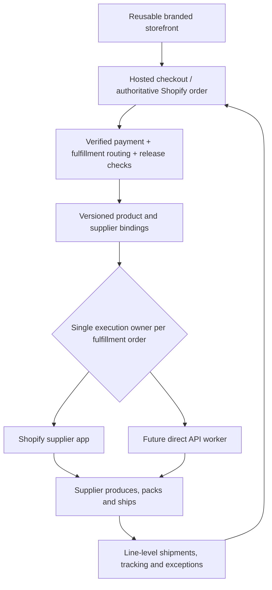

# Modular sourcing, production and fulfillment

Decision: the first decal launch should use a supplier that **prints, packs and ships each order**, as selected by the user. Date: October 17, 2026. No supplier, shipping account, production artwork, commerce backend or payment provider is connected yet.

## Recommended first launch

Latest decision (October 17, 2026): Shopify and Printful are the intended integration targets, with implementation deferred until review of the first 10 paid orders. The [future agent handoff](DOTS_AGENT_COMMERCE_HANDOFF.md) specifies a manual pilot and subsequent cutover. Product suitability and costs still need validation.

The [first-ten-order pilot](FIRST_TEN_ORDERS.md) now has a separate, opt-in Stripe-hosted checkout connection and manual Printful routine. It defaults to off; account setup and a real order are not yet verified. It does not use the demo fulfillment dispatcher or automatically submit supplier work.

Use the custom storefront with Shopify for authoritative commerce, then Printful's Shopify integration for production and fulfillment if product validation succeeds. **Printful is the intended provider and is not connected.** It advertises custom stickers with printing, packing and shipping, and a Shopify integration ([stickers](https://www.printful.com/custom-stickers), [Shopify integration](https://www.printful.com/integrations/shopify)). Confirm the exact sticker type, cut, finish, samples, packaging, origin, destinations, production times and landed costs before launch. The current $5 / matte / gloss UI catalog is illustrative, not a verified supplier offering or viable margin calculation.

Prefer a supplier's established Shopify integration where it meets the requirements. Set the execution owner to `shopify-app`. Our platform should then validate mappings, observe exceptions, and reconcile status; it must not submit a second direct API order for the same fulfillment work. A direct adapter is appropriate when the chosen provider lacks a suitable integration or requirements demonstrably demand it.

Shopify assigns fulfillment work into fulfillment orders associated with locations. Keep those groups distinct; do not collapse a whole order into one shipping destination or provider job ([official order-management model](https://shopify.dev/docs/apps/build/orders-fulfillment/order-management-apps)). A supplier integration must operate with its permitted locations and supported actions, rather than impersonating a different fulfillment service.

## Keep the responsibilities separate

| Responsibility | What is configured | What changes with a new product |
| --- | --- | --- |
| Commerce | Product/variant identity, retail price, payment/order state, refund state, inventory policy | Catalog records and valid supplier mappings |
| Sourcing/production | Supplier product ID, SKU, materials, size/finish, artwork/placement requirements | Supplier onboarding, approved production files and samples |
| Packaging | Supplier-standard or supported branded packaging profile | Packaging availability, inserts, costs, approved branding |
| Fulfillment | POD, warehouse/3PL, or self-fulfilled; assigned location and execution owner | Route and account configuration; adapter only for a new integration |
| Shipping | Supported destinations/services and compatible shipping profile | Rates, origin, parcel constraints, tax/customs and lead times |
| Tracking/support | Partial shipments, carrier tracking, exceptions, cancellation and returns | Provider status mapping and policy details |

A carrier or label API is a different role from a manufacturer/packer. For example, Shippo's shipment API retrieves rates from shipment addresses and parcels ([documentation](https://docs.goshippo.com/shipments/shipments)); it does not replace a product supplier or warehouse. A POD supplier can cover several roles behind one integration. Do not add separate carrier infrastructure when that supplier already handles shipment and tracking.

For stocked merchandise, manufacture or purchase the stock first, then use a warehouse for pick/pack/ship. A warehouse adapter does not imply someone manufactures the goods. Procurement/replenishment is a separate future process; this platform does not automatically source arbitrary products or negotiate supplier agreements.

## Foundation implemented now

All operations modules are under `src/server/fulfillment/` and are not imported by the storefront. Public brand props contain no supplier bindings or credentials.

- `types.ts`: common supplier capabilities; POD/warehouse/self-fulfilled routes; versioned SKU/variant/production asset bindings; packaging and shipping profiles; verified-commerce order snapshots; job/repository and adapter contracts; supplier order, quote, cancellation and line-level shipment shapes.
- `config.ts`: server-only demo mappings for **every launch variant** in Après Club, using POD, plus Desk Ritual's stationery variants using warehouse fulfillment. Provider IDs, location IDs and supplier variant IDs are explicitly demonstration values. Production asset sets, shipping profiles and packaging are unapproved.
- `planner.ts`: a working shared planner that validates mappings and capabilities, checks paid/active/unheld order eligibility, preserves commerce-assigned fulfillment groups, rejects unsupported countries/services/locations, and produces immutable job snapshots. Missing mappings block the whole snapshot instead of silently shipping only the recognized lines.
- `dispatch-demo.ts`: a working simulation-only adapter boundary with atomic repository claims, provider external-ID lookup, duplicate-delivery protection and a reconciliation stop on ambiguous failures.
- `demo.ts`: an explicitly in-memory repository and mock supplier. These never contact or charge a real supplier.
- `scripts/demo-fulfillment.ts`: exercises the same planner/dispatcher for POD decals and warehouse stationery, including a replay that reuses the original supplier order.

Run `pnpm demo:fulfillment`. This uses synthetic demo events; it does not convert browser checkout into a fulfillment event. The mock quote is an expired zero-valued placeholder, never a real production cost quote.

## Stable jobs and immutable mappings

The logical job identity is based on store, authoritative order and fulfillment-order IDs. It does not depend on webhook delivery ID, current supplier, configuration revision or retry attempt. An external ID is a 32-character deterministic hash-derived reference so provider adapters can translate it into their supported reference mechanism. Adapter-specific uniqueness/idempotency behavior still must be verified.

A job snapshots its supplier, SKU bindings, production asset sets, shipping/packaging profiles, location, service, quantities, and protected recipient reference/revision. Changing a mapping cannot silently create a second job or alter an already-claimed order. A differing fingerprint for the same logical job requires reconciliation. For partial fulfillment, snapshot the exact eligible remaining quantities from the commerce source. Replacements/reships are distinct authorized operations, not a replay with a changed quantity.

Never automatically switch an accepted or uncertain supplier order to another provider: that can cause two production charges and two shipments. A timed-out submission is quarantined for lookup/reconciliation, not blindly retried. Shopify-managed jobs must stay with the assigned app; the demo dispatcher explicitly refuses them.

## Production infrastructure still required

The contracts and simulation are working infrastructure foundations, **not a live operations service**. No production database, queue, webhook endpoint, scheduler, supplier HTTP adapter, credentials, or worker has been provisioned. In-memory simulation records disappear when the process exits and must never be used to process real orders.

For the selected Shopify-managed route, first connect and validate the native supplier app. Use Shopify and that app's supported order/fulfillment lifecycle as the operational source. Do not build a second production dispatcher just to match an abstraction.

If a direct integration becomes necessary, implement:

1. A verified webhook boundary that checks signatures, resolves the store, deduplicates receipts and durably enqueues work in one transaction. Client checkout state never authorizes production.
2. Authoritative paid-order and fulfillment-order retrieval, risk/hold/cancellation/refund checks, location permissions and remaining-line quantity checks. Recheck immediately before the irreversible production/label purchase action.
3. A durable implementation of `FulfillmentJobRepository` with unique logical job keys, transactional concurrency control/leases, immutable snapshots, durable results and reconciliation records. Use the chosen database/queue; the memory adapter is demo-only.
4. A real provider adapter with secret resolution, HTTP timeouts, bounded rate-aware retries, provider external-ID lookup, capability validation, and the provider's actual order confirmation protocol. Creating a draft and approving production may be different operations; production can charge the merchant.
5. Quotes and spending rules for production, packaging, shipping and taxes, with currency, expiry and an approved cost ceiling. Retail prices and supplier charges are different transactions. No automatic substitutions or unapproved artwork changes.
6. Normalized tracking webhooks and line-level partial shipment reconciliation. Label creation is not proof of carrier acceptance or delivery. Handle duplicate/out-of-order updates without moving an order backwards. Resolve recipient data from the protected commerce record and enforce its snapshot revision; redact it from logs and audit payloads.
7. Supported cancellation requests, including “requested” versus “cancelled” versus “too late.” A commerce refund does not prove the supplier cancelled production, and cancelling production does not automatically refund the customer.
8. Dead-letter/exception handling, low-balance or supplier-payment failures, address correction, restricted destinations, customer notifications, returns/replacements and periodic authoritative reconciliation. Document the human owner of unresolved exceptions.

Production asset approval must include the supplier's accepted file format, bleed, dimensions, placement, rights and a stored content digest. Browser concept SVGs are not automatically suitable print files. New packaging or material capabilities must be verified rather than assumed portable.

## Swapping the catalog or supplier

For a new product supported by an existing adapter, update public catalog/brand configuration and the separate server-side variant bindings: SKU, supplier product/variant ID, fulfillment mode/location, print assets, packaging, country/service rules and actual costs. Validate mappings for the entire catalog and run supplier samples plus test orders. Shared product cards, cart interactions and checkout handoff stay unchanged.

For a new provider, implement and contract-test one adapter or connect its compatible Shopify app, declare its actual capabilities, and configure credentials privately. A common interface does not make incompatible manufacturing processes or product categories interchangeable.

Initial limits: ordinary physical products, one store per deployment, explicit per-variant routing, no silent supplier fallback, no automatic global procurement, no dynamic cross-supplier bundles, no regulated or cold-chain goods, and no promise of universal packaging compatibility. Complex made-to-order personalization and kitting require a deliberate extension. One sales unit currently means one mapped supplier unit; multi-component bundles need an explicit bill of materials and inventory/fulfillment tests before use.

## Acceptance evidence

`tests/fulfillment.test.ts` covers both brand models; paid-order/hold/refund gates; all-variant mapping completeness; missing mappings; unsupported capabilities/packaging/destinations/services/locations; split fulfillment jobs; invalid/duplicate line quantities; live/demo separation and launch approvals; immutable routing/assets; webhook replay/concurrency; lookup after a lost response; timeout quarantine; cancellation; and refusal to dispatch Shopify-managed work from the demo engine.

The demo is not a supplier sandbox and does not validate real packaging, lead times, stock, print quality, postage, integration permissions or costs. Before launch, choose a supplier, approve samples/artwork and actual margins, connect Shopify/payment/supplier accounts, validate one end-to-end paid test order, confirm tracking and notifications, and complete cancellation/refund/failure drills.
